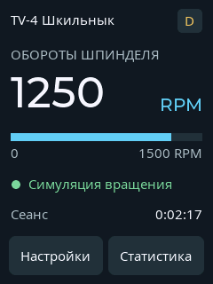

# ТВ-4 · Digital Control 1.0.3

Цифровая приборная панель шпинделя для ESP32-2432S028R, 240 × 320. При включении на семь секунд появляется «6 VOLT GARAGE» с поздравлением «С ДР, БРО!». Затем открывается тахометр с заголовком «TV-4 Шкильнык» размером 23 пикселя. Первый запуск использует **DEMO**, последующие восстанавливают выбранный режим. В **LIVE** источником оборотов служат импульсы датчика. Управление приводом и функции безопасности выполняет отдельная аппаратная схема. [Загрузочный экран](docs/splash.png)



## Первый запуск

Готовые образы для прошивки без компиляции собраны в архиве v1.0.2. Внутри находятся четыре приложения, загрузочные файлы и контрольные суммы. [Скачать выпуск](release/TV4-Digital-v1.0.2.zip) · [Инструкция по прошивке](docs/flash.md)

Для экземпляра на фотографиях проверен двухпортовый профиль ST7789/XPT2046. На стенде он работает по Micro-USB через CH340 на COM3. Для другой платы сначала подтвердите профиль тестом дисплея и касаний. Подключайте плату к USB отдельно от станка. Прошивка диагностического образа заменит заводскую демонстрацию. [Плата, резервная копия и проверка четырёх точек](docs/hardware.md)

Команды ниже рассчитаны на PlatformIO Core 6.1.19; в терминале PlatformIO IDE команда `pio` уже доступна. Для отдельной установки в PowerShell:

```powershell
py -m venv .venv
.\.venv\Scripts\python.exe -m pip install platformio==6.1.19
$env:Path = (Resolve-Path .\.venv\Scripts).Path + ';' + $env:Path
pio device list
```

1. Замените `COM7` фактическим портом платы. Соберите и загрузите тест.

   ```powershell
   pio run -e discovery-st7789 -t upload --upload-port COM7
   pio device monitor -p COM7 -b 115200
   ```

2. Проверьте надпись **TV-4 DIGITAL**, порядок цветов и все четыре прицела. После калибровки след от стилуса должен совпадать с точкой нажатия. Закройте монитор сочетанием Ctrl+C перед следующей загрузкой.
3. Установите основной интерфейс для подтверждённого профиля.

   ```powershell
   pio run -e panel-st7789 -t upload --upload-port COM7
   pio device monitor -p COM7 -b 115200
   ```

Для подтверждённой платы ILI9341 используйте пару `discovery-ili9341` и `panel-ili9341`. Обычная загрузка PlatformIO сохраняет раздел NVS. На чистой плате дождитесь тахометра и коснитесь экрана, чтобы открыть калибровку. Буква `c` в Serial открывает её повторно.

## Работа с панелью

| Экран | Действия и показания |
| --- | --- |
| Главный | Вверху справа **D** означает DEMO, **L** означает LIVE. Тахометр показывает RPM, шкалу, индикатор недавнего импульса, источник данных и время с включения. При потере сигнала LIVE показывает «Н/Д». |
| Настройки | Верхняя кнопка переключает DEMO/LIVE. Нажатие на строку параметра с символом **>** выбирает следующий параметр; кнопки **−** и **+** меняют значение. |
| Статистика | Длительность текущего цикла вращения, суммарные моточасы, максимум, среднее за время вращения и число обнаруженных пусков. Формат времени — часы, минуты, секунды. Сброс требует подтверждения и относится к указанному на экране режиму. |
| Диагностика | Две страницы со сведениями ESP, памятью, временем работы, причиной сброса, состоянием тача, датчика, RS-485, NVS и версией. Есть кнопка калибровки. |

DEMO моделирует разгон, полку, изменение скорости и замедление до нуля. Реальные моточасы сохраняются по подтверждённым интервалам. Последние незаписанные минуты могут потеряться при выключении питания. [Алгоритм, тайм-ауты и сохранение](docs/architecture.md) · [Согласование NPN и стендовый сигнал](docs/wiring.md)

## Сборка и тесты

```powershell
pio run -e discovery-st7789 -e discovery-ili9341 -e panel-st7789 -e panel-ili9341
```

Для тестов на компьютере нужны CMake и компилятор C++17. Основная сборка PlatformIO устанавливает LVGL в `.pio/libdeps/panel-st7789/lvgl`. Следующие команды проверяют ядро, сохранение и интерфейс на виртуальном экране через тот же код виджетов. Параметр `LVGL_DIR` можно опустить для запуска только тестов ядра и хранения.

```powershell
cmake -S test -B .pio/bench-host -DLVGL_DIR="$PWD/.pio/libdeps/panel-st7789/lvgl"
cmake --build .pio/bench-host --config Release
ctest --test-dir .pio/bench-host -C Release --output-on-failure
```

Используются Arduino-ESP32 2.0.17, Espressif32 6.12.0, TFT_eSPI 2.5.43 и LVGL 8.3.11. Драйвер XPT2046 находится в проекте. Точные версии пакетов заданы в [platformio.ini](platformio.ini). [Результаты проверок и аппаратная приёмка](docs/verification.md)
