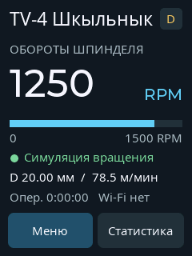

# TV-4 DIGITAL · 2.1.0

Сенсорная приборная панель для ТВ-4 на ESP32-2432S028, 240 × 320. Панель измеряет обороты, считает моточасы, хранит последние операции и помогает с расчётами токаря. На машине с этой сборкой пуск, останов, частота, реверс и аварийный останов относятся к независимой аппаратной системе.

## Начало работы

Для проверенной двухпортовой платы используйте профиль **panel-st7789**, резистивный тач XPT2046 и Micro-USB. При первом переходе с 1.0.4 обновите по USB также таблицу разделов. Журнал настроек и калибровка прежних версий читаются новой прошивкой. Перед записью на другую плату установите её тип, объём Flash и профиль дисплея. [Готовый выпуск 2.1.0](release/TV4-Digital-v2.1.0.zip) · [Установка и восстановление](docs/flash.md) · [Аппаратная конфигурация](docs/hardware.md)

На чистой панели через семь секунд после фотографии мотоцикла и поздравления открывается тахометр в DEMO. Сохранённая плата восстанавливает свой режим. В LIVE отсутствие пригодного измерения обозначено «Н/Д». Реальный вход ожидает фронты логического уровня 0–3,3 В на IO27. [Схема настольного стенда, питание и датчик](docs/wiring.md)

Вверху главного экрана крупно написано «TV-4 Шкыльнык». Справа `D` обозначает демонстрацию, `L` — показания с датчика.



## На панели

| Экран | Что доступно |
| --- | --- |
| Главная | Измеренные или явно демонстрационные RPM, шкала и состояние вращения, введённый диаметр, скорость резания, текущая операция, сеть |
| Графики | 30 секунд, 2 и 10 минут, пропуски данных, автоматическая шкала, минимум, максимум и среднее |
| Статистика | Моточасы, пуски, среднее по времени вращения и максимум, четыре последние операции и общее время питания |
| Точение, проточка, подачи | Ввод размеров и Vc, расчёт RPM, проходов и скорости движения |
| Резьбы, рычаги | Положения ручек по ростовскому шильдику, целевые и фактические обороты, настройка ручки частотника. Три заводских вида с буквами прямо на рычагах |
| DEMO | Готовый цикл разгона и остановки или ручное задание ползунком |
| Настройки и диагностика | Яркость, режим, порог, сглаживание, PPR, шкала, калибровка, Flash, RAM, вход тахометра и состояние сети |
| Wi-Fi / OTA | Временная защищённая точка настройки, STA, локальная веб-панель, обновление при отключённом приводе |

Основные экраны, измерение и расчёты доступны без сети и карты памяти. [Калькуляторы](docs/calculators.md) · [Резьбы](docs/threading.md) · [Рычаги](docs/tv4-controls.md) · [Хранение данных](docs/storage.md) · [Wi-Fi и OTA](docs/ota.md)

## Сборка

Откройте папку в PlatformIO IDE или установите PlatformIO Core в окружение Python. В проекте закреплены Espressif32 6.12.0, Arduino-ESP32 2.0.17, TFT_eSPI 2.5.43 и LVGL 8.3.11.

```powershell
py -m venv .venv
.\.venv\Scripts\python.exe -m pip install platformio==6.1.19
$env:Path = (Resolve-Path .venv\Scripts).Path + ';' + $env:Path
pio run -e panel-st7789
pio device list
```

После сверки конкретной платы используйте `pio run -e panel-st7789 -t upload --upload-port COM3`, заменив порт своим. Кроме основного профиля доступны panel-ili9341, соответствующие диагностические сборки и panel-st7789-ota. Веб-панель открывается с телефона или ноутбука по IP, указанному на экране. Вход в интерфейс обслуживания локальный.

[Тесты](docs/testing.md) · [Отчёт о выпуске 2.0.0](docs/final-report.md) · [Что проверить на станке](docs/open-questions.md) · [Проверки предыдущего выпуска](docs/verification.md)
