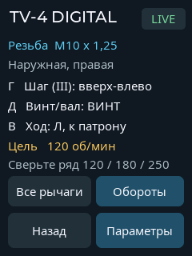

# Как выставить ТВ-4 для резьбы

В «Меню → Резьбы → Параметры» введите диаметр и шаг, выберите наружную или внутреннюю резьбу, правую или левую, материал и резец. Нажмите **Результат**. Панель покажет положения ручек и ориентир оборотов. Штатные шаги составляют 0,8, 1,0 и 1,25 мм. Для другого шага панель показывает доступные значения и скрывает настройки прохода. Шаг задаётся механической передачей.

## Пример для брата

Для наружной правой **M10 × 1,25** из обычной среднеуглеродистой стали с резцом HSS панель предлагает **120 об/мин**.

1. При остановленном шпинделе выставьте **Г (III) вверх-влево**, **Д на «ВИНТ»**, **В на «Л»**. В штатной компоновке передний резец пойдёт влево, к патрону. Проверьте ход с отведённым резцом.
2. В «Все рычаги» показаны **А (I) вниз-вправо**, **Б (II) вниз** для выбранной ступени. На фартуке **Ж на себя**, **З вниз от себя**. При настройке **И вверх**. Опускание **И** включает ход каретки для рабочего прохода.
3. В «Обороты» сравните цель с показанием **Датчик LIVE**. При измерении оборотов без резания регулируйте внешней ручкой частотника до целевого показания. В DEMO или при недоступном датчике панель сообщает об этом.

Кнопка «На рисунке» открывает три узла с нажимаемыми буквами. «Шильдик» показывает положения обеих скоростных рукояток и все три положения шага и подачи. [Расшифровка ручек](tv4-controls.md) · [Табличка ростовского ТВ-4](https://stanki-katalog.ru/info4/spr_tv4_foto_tab_b.jpg) · [Заводское руководство](https://ru.djvu.online/file/5cHSPhoRSGBfl)

## Как выбираются обороты

Для нарезания резцом используется колонка **Threading** таблицы 4-2 технического руководства TO 34-1-10. Прошивка берёт нижнюю границу для твердосплавного резца. Для быстрорежущей стали HSS применяется снижение на 50%, приведённое в примечании к таблице. Группа «Сталь» здесь означает среднеуглеродистую сталь. Для алюминия, латуни, чугуна и нержавеющей стали берутся отдельные строки. [TO 34-1-10, табл. 4-2, печатная стр. 4-34](https://www.robins.af.mil/Portals/59/10%20Dec_TO_34-1-10.pdf)

Панель переводит футы в метры и считает обороты как `1000 × Vc / (π × диаметр резьбы)`. Из ряда шильдика выбирается ближайшая ступень, которая укладывается в расчёт. В примере Vc составляет 4,572 м/мин, расчёт даёт 145,5 об/мин, доступная ступень — 120. Выше последней ступени цель ограничена 710. Ниже первой ступени выводятся расчётные обороты и просьба сверить допустимый диапазон частотника и двигателя. Марка сплава, конкретная пластина, глухая резьба и фактическое место для выхода резца могут потребовать меньшей скорости. Значение Vc из калькулятора обычного точения хранится отдельно.

## Как получить процент на ручке

B5K подключён к частотнику. ESP32 получает обороты от датчика. Процент поворота можно оценить по двум измерениям на **той же механической ступени**.

1. Выберите «Обороты → Шкала ручки». Выставьте первую известную метку физической ручки в допустимом диапазоне. После установления оборотов выставьте на экране тот же процент кнопками «−5» и «+5» и нажмите «Записать точку 1».
2. Повторите с другой меткой и другими оборотами для точки 2. При одинаковых метках либо оборотах запись отклоняется. Для записи требуется работающий датчик в LIVE.
3. Между измеренными значениями «Обороты» показывает примерную установку в процентах. Например, 25% при 80 об/мин и 75% при 160 об/мин дают около 50% для цели 120. Эти числа иллюстрируют расчёт. За пределами измерений ориентируйтесь по LIVE. При нелинейной настройке привода процент также уточняют по тахометру.

Пары записываются в энергонезависимую память отдельно для каждой из шести ступеней. После изменений в настройках частотника, замены шкивов или перестановки ручки запишите обе точки заново.

## Где найти размеры профиля

В «Параметры → Размеры» доступны базовые размеры метрического профиля 60°. **H** — высота исходного треугольника, **d2** — средний диаметр резьбы. Высота треугольника служит для расчёта профиля. Глубину врезания и допуски определяют по чертежу и инструменту.

| Размер | Формула для диаметра D и шага P |
| --- | --- |
| Высота исходного треугольника | 0,8660254 × P |
| Средний диаметр | D − 0,649519 × P |
| Диаметр дна наружной впадины | D − 1,226869 × P |
| Базовый малый диаметр внутренней резьбы | D − 1,082532 × P |
| Ориентировочное сверло под режущий метчик | D − P. Показано только для внутренней резьбы |
