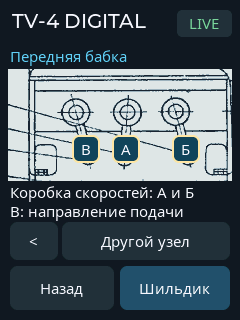

# Ручки и шильдик ТВ-4

В «Рычаги ТВ-4» три узла. Передняя бабка содержит коробку скоростей и трензель. За ней в справочнике идут коробка подач и фартук. Нажмите цветную букву прямо на рукоятке, чтобы открыть её карточку. Буквы введены для этого дисплея. Римские I, II и III перенесены с шильдика, а номера 1–9 относятся к рисунку 1 заводского руководства.

| Буква | № на рис. 1 | Рукоятка | Для резьбы |
| --- | --- | --- | --- |
| А | 1 | Скорость I, средняя на передней бабке | Одно из двух положений по строке скорости |
| Б | 2 | Скорость II, правая на передней бабке | Одно из трёх положений в той же строке |
| В | 3 | Трензель, левая на передней бабке | При обычном переднем резце и штатном прямом вращении «Л» даёт ход к патрону для правой резьбы. Для левой нужен ход вправо, «П». Направление проверяют с отведённым резцом |
| Г | 4 | Шаг и подача III, правая ручка коробки подач | Выбирает шаг резьбы |
| Д | 5 | Винт / вал, левая ручка коробки подач | К надписи «ВИНТ». Для обычной продольной подачи выбирают «ВАЛ» |
| Е | 6 | Маховик каретки | Служит для ручного перемещения |
| Ж | 7 | Кнопка реечной шестерни | Вытянуть на себя |
| З | 8 | Самоход | Выключить, вниз от себя |
| И | 9 | Маточная гайка | При настройке вверх. Для рабочего прохода опустить, чтобы каретка пошла от ходового винта |

Рычаги коробок переставляют при остановленном шпинделе. Маточная гайка относится к отдельному этапу рабочего прохода. Положения даны при взгляде спереди. [Заводское руководство 1968 года, рис. 1 и раздел о нарезании резцом](https://ru.djvu.online/file/5cHSPhoRSGBfl) · [Рисунок с заводской нумерацией](https://stanki-katalog.ru/info4/spr_tv4_upr_b.jpg) · [Расположение I и II на передней бабке](https://stanki-katalog.ru/info4/spr_tv4_foto8_b.jpg)

## Ростовский шильдик

За образец для подарочной панели принят комплект ТВ-4 завода № 1 учебного оборудования, Ростов-на-Дону. На экране «Шильдик» круг обозначает ось, линия направлена к свободному концу ручки. Обе таблицы доступны офлайн. [Изображение комплекта и исходная таблица](https://stanki-katalog.ru/info4/spr_tv4_foto_tab_b.jpg)

| Номинал шпинделя, об/мин | А, ручка I | Б, ручка II |
| --- | --- | --- |
| 120 | вниз-вправо | вниз |
| 180 | вниз-вправо | вниз-вправо |
| 250 | вниз-вправо | вниз-влево |
| 390 | вниз-влево | вниз |
| 500 | вниз-влево | вниз-вправо |
| 710 | вниз-влево | вниз-влево |

| Шаг с ходовым винтом, мм | Подача с ходовым валом, мм/об | Г, ручка III |
| --- | --- | --- |
| 0,8 | 0,08 | вверх |
| 1,0 | 0,10 | вверх-вправо |
| 1,25 | 0,12 | вверх-влево |

В руководстве 1968 года есть также ряд 120/160/230/375/500/710. Подарочная прошивка использует ряд 120/180/250/390/500/710 с выбранной таблички. Если на конкретном станке другой ряд или менялись шкивы, ориентиром служат его маркировка и фактический тахометр. Для переключателя Д выводится слово «ВИНТ» или «ВАЛ», поскольку пиктограммы выбранной таблички и словесное описание старого руководства различаются по направлению. [Помощник резьбы](threading.md)
