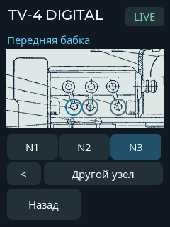

# Рычаги штатного ТВ-4

Вкладка «Рычаги ТВ-4» открывается из меню, расчёта подачи и карточки штатной резьбы. Кнопка «Другой узел» увеличивает следующую область рисунка. Касание кольца на рисунке либо номера под ним открывает карточку. При переходе из расчёта цветом выделены относящиеся к операции органы.

| № на рис. 1 | Узел и функция | Резьба | Продольная подача |
| --- | --- | --- | --- |
| 1, 2 | Две ступени коробки скоростей в передней бабке | Комбинация по табличке скорости | Комбинация по табличке скорости |
| 3 | Трензель передней бабки задаёт направление хода | Сверить нужный ход суппорта и маркировку Л/Н/П | По требуемому направлению |
| 4 | Селектор коробки подач | Ряд выбранного шага на табличке | Ряд выбранной подачи на табличке |
| 5 | Переключение винт/вал | Винт, вправо до упора | Вал, влево до упора |
| 6 | Маховик ручного продольного перемещения | Постоянного положения нет | Постоянного положения нет |
| 7 | Кнопка реечной шестерни на фартуке | На себя | На себя |
| 8 | Самоход от ходового вала | Выключен, вниз от себя | На себя, включён |
| 9 | Маточная гайка ходового винта | Нижнее положение, замкнута | Верхнее положение, разомкнута |

Нумерация и сочетания относятся к рис. 1 и разделу об управлении в руководстве 1968 года, печатные стр. 2–3 и 15–16. Для сверки конкретного экземпляра используйте его таблички, особенно у модернизированного привода. Электрические органы управления не подключены к панели. [Заводское руководство](https://ru.djvu.online/file/5cHSPhoRSGBfl)

Во Flash записаны четыре увеличенных фрагмента фронтального чертежа, по 224 × 112 пикселей и четыре цвета. Скрипт `tools/make_control_drawings.py` принимает исходный JPG размером 1200 × 966. Обзорный фрагмент передней бабки и увеличенный вид коробки скоростей относятся к одному агрегату. [Исходный рисунок 1](https://stanki-katalog.ru/info4/spr_tv4_upr_b.jpg) · [Каталог модели ТВ-4](https://stanki-katalog.ru/sprav_tv4.htm)
